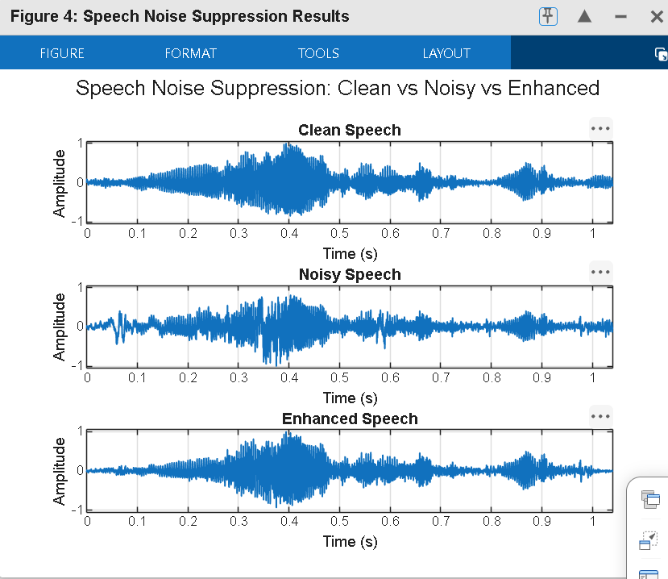
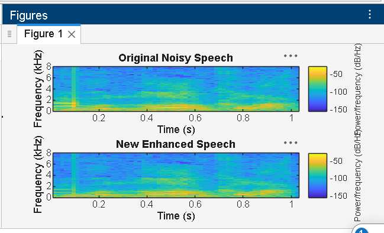
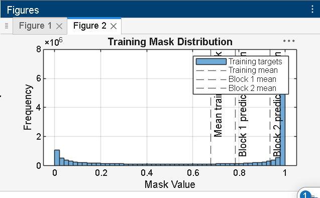

# Speech Background Noise Suppression Using Deep Learning

A MATLAB-based speech enhancement prototype that uses a U-Net-style convolutional neural network to suppress background noise and improve speech quality.

## Overview

Background noise can reduce speech clarity and make communication difficult. This project explores deep learning-based speech enhancement by estimating a time-frequency mask from noisy speech and using it to reconstruct an enhanced audio signal.

The prototype implements a workflow involving Short-Time Fourier Transform (STFT), neural-network-based spectral-mask estimation, and Inverse Short-Time Fourier Transform (ISTFT).

## Objectives

- Develop a deep learning-based speech noise suppression prototype in MATLAB.
- Estimate a spectral mask to reduce unwanted noise components.
- Compare noisy and enhanced speech using waveform and spectrogram visualizations.
- Evaluate enhancement performance using objective speech-quality metrics where supported.

## System Workflow

Noisy Speech → STFT → Magnitude Feature Extraction → U-Net Mask Estimation → Spectral Mask Application → ISTFT → Enhanced Speech → Evaluation

## Technologies Used

- MATLAB
- Deep Learning Toolbox
- Signal Processing Toolbox
- Short-Time Fourier Transform (STFT)
- U-Net-style convolutional neural network
- Spectral-mask-based speech enhancement

## Methodology

1. **Dataset preparation:** Load clean speech and noise recordings, resample them to the required sampling frequency, and prepare fixed-length audio segments.
2. **Noisy speech generation:** Mix clean speech with noise at selected signal-to-noise ratios (SNRs).
3. **Feature extraction:** Apply STFT to represent the audio in the time-frequency domain.
4. **Model training:** Train a neural network to estimate a spectral mask from noisy-speech magnitude features.
5. **Speech enhancement:** Apply the predicted mask to the noisy magnitude spectrogram and use the noisy phase for waveform reconstruction.
6. **Reconstruction:** Apply ISTFT to obtain the enhanced speech waveform.
7. **Evaluation:** Compare input and enhanced speech using visualizations and available objective metrics.

## Model Architecture

The project includes a U-Net-style encoder-decoder model and a compact CNN alternative for spectral-mask estimation.

The encoder-decoder design extracts time-frequency features at different resolutions. Skip connections help transfer features between corresponding encoder and decoder stages.

The estimated mask is applied to the noisy speech magnitude spectrum before waveform reconstruction.

## Repository Structure

```text
speech-background-noise-suppression/
├── build_dataset.m
├── build_model.m
├── build_unet_model.m
├── config.m
├── enhance_speech.m
├── evaluate_prototype.m
├── launch_prototype.m
├── train_noise_suppressor.m
├── run_demo.m
├── prototype_waveform_comparison.png
├── clean_enhanced_noise_graph.png
├── spectogram_ss.png
├── training_mask_distribution.png
└── README.md
```

## Results and Visualizations

### Clean, Noisy and Enhanced Speech

This comparison shows the clean reference speech, noisy input, and enhanced output waveform.



### Spectrogram Comparison

The time-frequency representations help visualize how the speech spectrum changes after enhancement.



### Training Mask Distribution

The histogram illustrates the distribution of spectral-mask values in the training targets.



## Evaluation Metrics

The project uses or considers the following metrics, depending on implementation availability:

- **SNR (Signal-to-Noise Ratio):** Measures signal strength relative to noise.
- **SNR Improvement:** Measures the change in SNR after enhancement.
- **STOI (Short-Time Objective Intelligibility):** Estimates speech intelligibility.
- **SI-SDR (Scale-Invariant Signal-to-Distortion Ratio):** Evaluates the enhanced signal against a reference while accounting for scale.
- **PESQ (Perceptual Evaluation of Speech Quality):** Estimates perceived speech quality when a compatible implementation is available.

Only metrics actually computed by the current implementation should be reported as experimental results. Numerical performance values will be added after verification of the evaluation output.

## How to Run

1. Install MATLAB and the required toolboxes.
2. Place clean speech WAV files in `data/clean` and noise WAV files in `data/noise`.
3. Open the project folder in MATLAB.
4. Review the paths and parameters in `config.m`.
5. Run `run_demo.m` for the demonstration workflow, or follow the separate dataset-building and training scripts for a full experiment.
6. Inspect the generated enhanced audio and evaluation plots.

**Note:** Exact execution steps may depend on the MATLAB release, available toolboxes, dataset paths, and the scripts' current configuration.

## Limitations

- The current implementation is a working prototype, not a claim of production-ready or research-grade performance.
- Speech reconstruction retains the noisy input phase.
- Performance depends on the training data, noise conditions, network configuration, and available computing resources.
- Real-time performance must be verified through latency measurements before making real-time processing claims.

## Future Scope

- Evaluate generalization across unseen noise types and SNR levels.
- Improve speech intelligibility and perceptual quality.
- Compare U-Net and compact CNN performance.
- Validate objective metrics against reference implementations.
- Investigate real-time speech enhancement.

## Acknowledgements

The project draws on established deep learning and time-frequency speech-enhancement techniques. Dataset sources and relevant research references should be credited in the final project documentation.

## Author

**Annant Kaur Virdi**

GitHub: [anna31-kv](https://github.com/anna31-kv)
